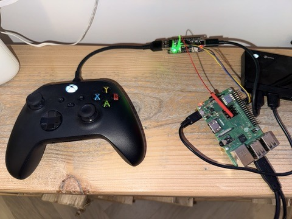
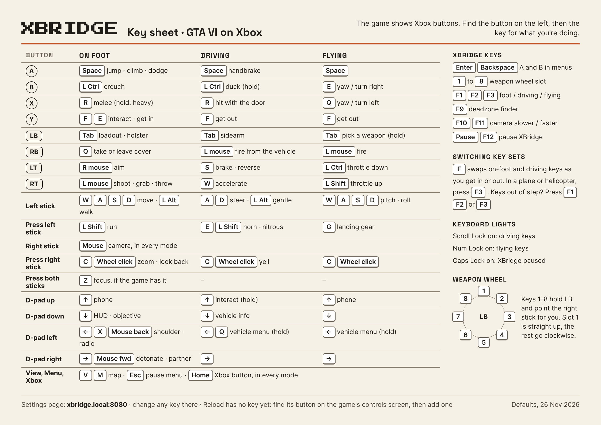
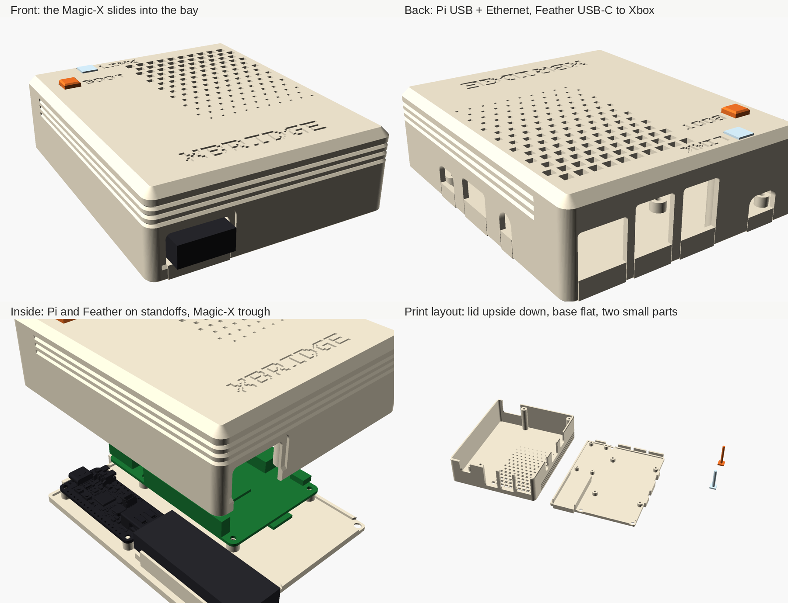

# XBridge

Mouse and keyboard for GTA VI on Xbox Series X|S.

GTA VI doesn't support mouse and keyboard on Xbox, so this makes the Xbox think a normal wired controller is plugged in. A Raspberry Pi reads the mouse and keyboard and does the GTA-specific bits. A small RP2040 board plugs into the Xbox and acts as the controller. No soldering.



- Mouse turns the camera, tuned for how GTA's camera reacts (deadzone finder, speed keys, smoothing)
- Separate key sets on foot, driving and flying, swapped automatically when you get in or out
- Steering and throttle ease in, like a stick rather than an on/off key
- Number keys 1 to 8 pick weapon wheel slots for you
- Settings page on your phone to change any key
- Optional 3D-printed case

## How it works

```
mouse + keyboard ──USB──▶ Raspberry Pi 3 B+ ──3 wires──▶ Feather RP2040 USB Host ──USB-C──▶ Xbox
                          (does the GTA-specific           │
                           translation)                    └─ USB-A: Magic-X dongle or an Xbox
                                                              controller (gets it past the
                                                              Xbox's security check)
```

The Xbox only accepts Microsoft-approved controllers. It asks each one a coded question that only an approved chip can answer. The Feather passes the question to the approved device plugged into it and hands back the answer. Everything else is the Feather pretending to be a wired pad, fed 200 times a second by the Pi.

The Feather runs [GP2040-CE](https://github.com/OpenStickCommunity/GP2040-CE) with a small add-on that takes the controller state from the Pi.

## What you need

| Item | Price (The Pi Hut, Nov 2026) | What it's for |
|---|---|---|
| [Adafruit Feather RP2040 with USB Type A Host](https://thepihut.com/collections/adafruit-development-boards/products/adafruit-feather-rp2040-with-usb-type-a-host) | £16.80 | Pretends to be the controller |
| [STEMMA QT / Qwiic JST-SH 4-pin cable to female jumper wires, 150mm](https://thepihut.com/products/stemma-qt-qwiic-jst-sh-4-pin-cable-with-premium-female-sockets-150mm-long) | £1 | Connects the Pi to the Feather |
| USB-A to USB-C cable that carries data (not a charge-only one) | from £2.25 | Feather to Xbox |
| [Mayflash Magic-X](https://mayflash.com/product/magic_x.html), **or** an Xbox controller you already have | varies | Gets the Feather past the Xbox's security check |
| Raspberry Pi 3 B+ with its power supply | | The brain |
| microSD card, 8 GB or bigger | | For the Pi |
| Mouse and keyboard (wired, or wireless with its USB dongle) | | |

**Magic-X or controller?** Any Microsoft Xbox One or Series controller, or a wired PowerA one, has the approved chip. The firmware accepts either. A controller needs its own data cable to the Feather (USB-C for a Series pad, micro-USB for an older Xbox One pad), and it's tied up while you play. So it suits a spare. The Magic-X is smaller and fits the case's front bay.

## Setup

| Step | What you do | You need | Rough time |
|---|---|---|---|
| 1 | Put the program on the Feather | Computer, Feather, data cable | 5 min |
| 2 | Prepare the Pi's SD card | Computer, SD card | 20 min |
| 3 | Install XBridge on the Pi | Computer, Pi on your network | 15 min |
| 4 | Wire the Feather to the Pi | Pi, Feather, STEMMA QT cable | 5 min |
| 5 | Plug it all in and check | Everything, plus the Magic-X or a controller | 5 min |
| 6 | GTA VI settings | Xbox, GTA VI | 5 min |
| 7 | Tune the mouse | Xbox, GTA VI | 10 min |

Steps 2 and 3 only need the Pi and a computer, so you can do them while you wait for the Feather.

First, get the files: on this page press **Code → Download ZIP** and unzip it.

### Step 1: Put the program on the Feather

1. Find `XBridge-Feather.uf2` in the `firmware` folder.
2. Hold down the **BOOT** button on the Feather, plug its USB-C into your computer with a data cable, then let go. A drive called **RPI-RP2** appears, like a USB stick.
3. Drag `XBridge-Feather.uf2` onto that drive. The drive disappears after a few seconds: that's the Feather restarting with its new program.
4. The small red light next to the USB-C port blinks slowly. That means it's running and waiting for the Pi.

No drive? The cable is probably charge-only. Try another one.

### Step 2: Prepare the Pi's SD card

Raspberry Pi Imager puts Raspberry Pi OS Lite (64-bit) on the card, with your Wi-Fi and login already set up. This wipes the card.

1. Put the SD card in your computer.
2. Install the latest [Raspberry Pi Imager](https://www.raspberrypi.com/software/). Older versions quietly skip your settings on the current Raspberry Pi OS, and then you can't log in.
3. **Device:** Raspberry Pi 3.
4. **Operating system:** Raspberry Pi OS (other) → **Raspberry Pi OS Lite (64-bit)**. No desktop needed.
5. **Storage:** your SD card. Check the size so you don't wipe the wrong drive.
6. **Customisation** (don't press Skip customisation):
    - **Hostname:** `xbridge`
    - **Location:** your capital city. This sets the time zone, keyboard and Wi-Fi country.
    - **User:** a lowercase username that isn't `pi`, and a password of letters and numbers. Write them down.
    - **Wi-Fi:** your network name and password, exactly. Skip it if the Pi will use a network cable.
    - **Remote access:** SSH on, with password login.
    - Everything else: leave it.
7. Press **Write**. It takes about 10 minutes.
8. Pull the card out and push it back in. A drive called **bootfs** appears. (A Mac may say a disk isn't readable: click Ignore. That's the Pi's own part of the card.)
9. Copy the [`pi`](pi) folder from this repo onto **bootfs** and rename the copy `xbridge`. Eject the card.

### Step 3: Install XBridge on the Pi

1. Put the card in the Pi and power it up (plus a network cable if you're not using Wi-Fi). Wait five minutes. The first start is slow and it restarts itself once.
2. Open Terminal on a Mac, or PowerShell on Windows.
3. Type `ssh yourname@xbridge.local`, with your username from Imager, and press Enter.
4. The first time, it asks whether you trust the Pi: type `yes`.
5. Type your password. Nothing shows while you type. That's normal.
6. Once the line starts with `yourname@xbridge`, run:
   ```
   sudo bash /boot/firmware/xbridge/install.sh
   ```
7. The installer copies the program over, switches on the two pins the Feather uses, and sets XBridge to start with the Pi. Then it restarts the Pi.
8. A minute later, open **http://xbridge.local:8080** on your phone or computer (same Wi-Fi). That's the settings page.

Plug the mouse and keyboard into the Pi. On the settings page the stick circles move when you move the mouse or press WASD. "Feather not answering" is expected until Step 4.

### Step 4: Wire the Feather to the Pi

Three wires, with the Pi switched off: **black to pin 14, blue to pin 16, yellow to pin 18**. The red wire isn't used.

1. Unplug the Pi.
2. Push the small white plug into the Feather's 4-pin socket (labelled STEMMA QT). It only fits one way.
3. Hold the Pi with its USB ports on your right, so the double row of pins runs along the top edge. Use the outer row, nearest the edge, and count from the left:

```
outer row, from the left:  1st  2nd  3rd  4th  5th  6th  7th    8th   9th
pin number:                 2    4    6    8   10   12   14     16    18
                           5V   5V                       black  blue  yellow
                           ▲ never put a wire on these two
```

4. Tape over the red wire's end so it can't touch anything.

**Never put a wire on the first two pins of that row (pins 2 and 4).** They carry 5 volts and would kill the Feather.

These aren't the Pi's usual pins for this kind of link, on purpose. The usual ones would leak power into the Feather whenever the Xbox is off. These don't.

### Step 5: Plug it all in and check

You're looking for three green labels on the settings page: **Feather connected**, **Xbox connected**, **Security check passed**.

1. Plug the security device into the Feather's USB-A port:
    - **Magic-X:** its light should be blue (Xbox mode). Red? Press the button on its side.
    - **Xbox controller:** take the batteries out, then connect it with its data cable. Without batteries it can't also connect to the Xbox wirelessly.
2. Plug the Feather's USB-C into any Xbox USB port. The Xbox powers the Feather.
3. Power up the Pi, with the mouse and keyboard plugged in.
4. Turn the Xbox on and open the settings page. The security check takes a few seconds. The Feather's red light goes solid once the Pi's data is arriving.
5. Try the home screen: arrow keys move, Enter is A, Backspace is B, Home is the Xbox button.

### Step 6: GTA VI settings

Turn camera acceleration off and sensitivity to maximum in the game. The Pi does the fine tuning.

| Setting | Set to | Why |
|---|---|---|
| Control scheme | Default | The key layout is built on it |
| Look Acceleration, Aim Acceleration | Lowest | Acceleration feels like mouse acceleration |
| Look Sensitivity (horizontal and vertical) | Highest | Raises the camera's top speed. The Pi controls the feel |
| Aim Sensitivity (horizontal and vertical) | Highest | Same, while aiming |
| Aim Response Curve | Linear if offered, otherwise Standard | The Pi's Response curve setting allows for it |
| Right stick deadzone, if there is one | Lowest | Less dead patch for the Pi to jump over |
| Aim assist | Your call | It stays on, because the game thinks it's a controller |

Setting names come from [Dexerto's GTA VI controller settings guide](https://www.dexerto.com/wikis/gta-6/best-controller-settings/). If a name in the game is slightly different, go with the closest match.

### Step 7: Tune the mouse

A mouse says "moved this far", but a stick means "keep turning at this speed". So the Pi works out how fast the mouse is moving and pushes the stick to match. It also jumps over the game's deadzone (the patch in the middle of the stick where small pushes do nothing), so tiny movements still turn the camera.

1. **Deadzone (F9):** stand still on foot and press F9. The camera starts creeping right very slowly. The moment it moves, press F9 again. Saved.
2. **Speed (F10 slower, F11 faster):** 5% per press. It changes whichever speed you're using at the time: looking, aiming (hold right mouse while you press it) or driving.
3. **Feel**, on the settings page:
    - Floaty or laggy: lower **Smoothing** to about 10.
    - Jittery: raise **Smoothing** to 20–25.
    - Small movements sluggish but big ones too fast: raise **Response curve** to 1.5, then 2.
    - Up and down too quick: lower **Up/down speed**.
    - Fast flicks hit a ceiling: that's the game's top turning speed, so check Look Sensitivity is at maximum.

## Controls

[](keysheet/XBridge-key-sheet.pdf)

The key sheet is one A4 page: [PDF](keysheet/XBridge-key-sheet.pdf) to print. The game shows Xbox buttons, so find the button, then the key for what you're doing.

- **Switching key sets:** F swaps between on-foot and driving keys as you get in or out. In a plane or helicopter, press F3. If the keys get out of step, press F1 (on foot), F2 (driving) or F3 (flying).
- **Keyboard lights:** Scroll Lock on means driving keys, Num Lock means flying, Caps Lock means XBridge is paused.
- **Weapon wheel:** keys 1–8 hold LB and point the right stick at the slot. Slot 1 is straight up, the rest go clockwise. That layout is a guess until checked against the real wheel; the directions can be changed on the settings page.
- **Reload** has no key yet, because the published control list doesn't include it. Check the game's controls screen, then use **Add a key** on the settings page.

The layout follows GTA VI's Default controller scheme as listed by [GTABase](https://www.gtabase.com/articles/gta-6/gta-6-controls-guide-ps5-xbox-button-layout). Every key can be changed on the settings page.

## Fixing problems

**Logging into the Pi**

| What you see | Fix |
|---|---|
| "Could not resolve hostname xbridge.local" | The Pi isn't on your network. Wait five minutes after first power-up. Still nothing? Check the Wi-Fi name in Imager matches the network your computer is on, or use a network cable. Your router's device list shows the Pi's address if you'd rather connect by number. |
| `ssh` just hangs | Same as above: your computer can't reach the Pi. |
| "Permission denied, please try again" | Wrong username or password. Use `ssh yourname@xbridge.local`; without the name, your computer sends its own username. |
| "Permission denied (publickey)" | Imager was set to key-only login. Write the card again with password login. |
| "Connection refused" | SSH is off, so Imager's settings didn't apply. Update Imager and write the card again. |
| "REMOTE HOST IDENTIFICATION HAS CHANGED" | Normal after writing the card again. Run `ssh-keygen -R xbridge.local`, then connect again. |

**Once it's running**

| What you see | Fix |
|---|---|
| "Feather not answering" | Is the Xbox on? It powers the Feather. Check the wires are on pins 14, 16 and 18, and that the Pi restarted after the install. |
| Feather's red light off | No power: try another Xbox USB port or cable. |
| Red light blinking slowly with the Xbox on | The Pi's data isn't reaching it: check the wires. |
| "Xbox not connected" | The cable is probably charge-only. Try another cable or port. |
| "Waiting for security check" for over a minute | Magic-X: light blue? Controller: data cable, batteries out? Then unplug the Feather from the Xbox and plug it back in. A Magic-X that still won't pass may need a firmware update from Mayflash. |
| "No keyboard or mouse found" | They plug into the Pi, not the Xbox. A wireless set needs its dongle in the Pi. |
| Camera creeps on its own | Deadzone too high: run F9 again. |
| Small mouse movements do nothing | Deadzone too low: run F9 again. |
| Keys doing the wrong thing | Check the mode on the settings page or the keyboard lights. F1 puts you back on foot. |
| A key does nothing in the game | Look it up on the key sheet, then check what that button does on the game's controls screen. |

## Good to know

- **Pause or F12** lets go of every button and stick until you press it again.
- **Safety net:** if the Pi stops sending for a tenth of a second (crash, loose wire), the Feather lets go of everything, so nothing gets stuck held down.
- **Updating the Pi:** copy the new `pi` folder over `xbridge` on the card's bootfs drive and run the install command again. Your settings are kept. To pick up a new default key layout, press Defaults then Save on the settings page (that resets the mouse settings too).
- **Updating the Feather:** repeat Step 1 with the new file.
- **Removing it:** `sudo bash /boot/firmware/xbridge/uninstall.sh`, then `sudo reboot`.
- **Online play:** XBridge only remaps keys. No rapid fire, no recoil scripts. In GTA Online any adapter could break Rockstar's or Microsoft's rules, so that's at your own risk.

## 3D-printed case



A retro-style case for the Pi, the Feather and the Magic-X: 96 × 116 × 33 mm, four parts, no supports. There's a clear lens over the Feather's link light, and a BOOT key on top so you can reflash the Feather without opening it. STLs, print settings and assembly are in [`case/`](case).

## What's in here

| Folder | What |
|---|---|
| [`pi/`](pi) | The Pi program, installer, uninstaller and tests (`cd pi && python3 -m unittest discover -s tests`) |
| [`firmware/`](firmware) | Ready-built `XBridge-Feather.uf2`, plus the GP2040-CE patch, how to rebuild it, and a host test rig |
| [`case/`](case) | 3D-printable case: STLs and the Python that generates them |
| [`keysheet/`](keysheet) | Printable A4 key sheet (PDF and PNG) |

## Credits and licence

- Feather firmware is [GP2040-CE](https://github.com/OpenStickCommunity/GP2040-CE) (MIT) with an XBridge add-on. Its licence is in [`firmware/GP2040-CE-LICENSE.txt`](firmware/GP2040-CE-LICENSE.txt).
- Lettering on the case and key sheet uses [Press Start 2P](https://github.com/google/fonts/tree/main/ofl/pressstart2p) (SIL Open Font License).
- Everything else here is MIT licensed: see [LICENSE](LICENSE).

Not affiliated with Rockstar Games, Take-Two, Microsoft, Mayflash, Adafruit or Raspberry Pi.
