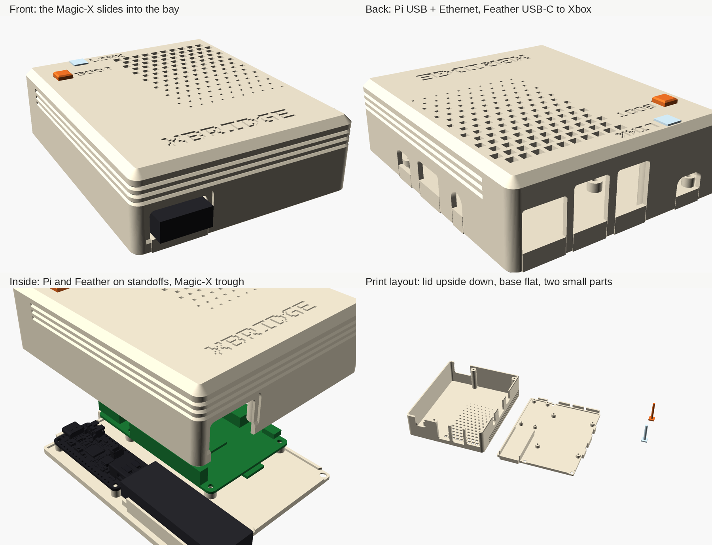

# XBridge case

A retro-style case for the Raspberry Pi 3 B+, the Adafruit Feather RP2040 USB Host and the Mayflash Magic-X.
Outside size: 96 × 116 × 33 mm. All four parts print without supports.

## Print

| File | Lay it on the bed | Estimate (PrusaSlicer, default speeds) |
|---|---|---|
| `print/xbridge_lid.stl` | already upside down: roof on the bed | 55 g, about 6 h 40 m |
| `print/xbridge_base.stl` | already flat | 31 g, about 3 h 45 m |
| `print/xbridge_lens.stl` | head down (as supplied); clear or natural filament glows best | under 1 g, 5 m |
| `print/xbridge_boot_key.stl` | head down (as supplied); an accent colour looks good | under 1 g, 4 m |

Settings: 0.2 mm layers, 4 walls, 15% infill, no supports. PLA is fine; use PETG if the case will sit in the Xbox's
warm exhaust air. Faster printers (Bambu, Prusa MK4 and similar) take roughly half those times.

**Two-colour badge (optional).** The lid prints upside down, so the engraved XBRIDGE, LINK and BOOT lettering is
in the first layers. With 0.2 mm layers, add a filament change at the 0.8 mm layer (your accent colour) and another at
1.0 mm (back to the main colour). The letters come out in the accent colour.

## You'll need

- 6 × M2.5 × 6 mm screws: 4 for the Pi, 2 for the Feather
- 3 × M3 × 10 mm countersunk screws: base to lid
- 4 × stick-on rubber feet, 10 mm (optional; the base has shallow pockets for them)

The screws cut their own thread into the printed holes; don't overtighten.

## Assemble

1. Screw the Pi onto its four posts: USB and Ethernet to the back, power and HDMI to the right.
2. Sit the Feather on its four posts: USB-A end over the two pins at the front, USB-C end at the back. Two screws at the USB-C end.
3. Fit the wires: STEMMA QT cable into the Feather, black/blue/yellow onto Pi pins 14/16/18 (Step 4 of the main README).
4. Using an Xbox controller instead of the Magic-X? Feed its cable in through the front slot now and plug it into the
   Feather's USB-A port. The plug can't reach the socket from outside once the lid is on.
5. Lower the lid straight down so the ports drop into their openings. Turn it over and fit the three M3 screws from underneath.
6. Drop the lens (rod first) into the square hole marked LINK, and the BOOT key into its hole.
7. If you're using the Magic-X, slide it into the front bay, connector first, until it plugs into the socket. About 5 mm
   stays out so you can grip it.
8. Stick on the feet.

To reflash the Feather with the case closed: unplug its USB-C cable from the Xbox, hold the BOOT key down while you plug
that cable into your computer, then drag the new `.uf2` onto the drive that appears.

## How the fit was checked

Every part was collision-checked against the boards: the Pi from Raspberry Pi's official mechanical drawing, the
Feather from Adafruit's own 3D model, and the Magic-X from Mayflash's published size (73 × 21 × 8.7 mm). All clear,
including with the boards nudged 0.3 mm in every direction, and the parts were run through PrusaSlicer.
The Magic-X's plug is assumed to be centred on its body; the bay and trough leave about 1 mm of slack each side.

## Source

`source/xbridge_case.py` builds the parts (Python with `manifold3d` and `trimesh`); `source/check_fit.py` runs the fit
checks and needs Adafruit's Feather model in `source/ref/cad/` (from github.com/adafruit/Adafruit_CAD_Parts, folder
"5723 Feather RP2040 USB Host"). Lettering uses the Press Start 2P font (SIL Open Font License, `source/ref/OFL.txt`).
